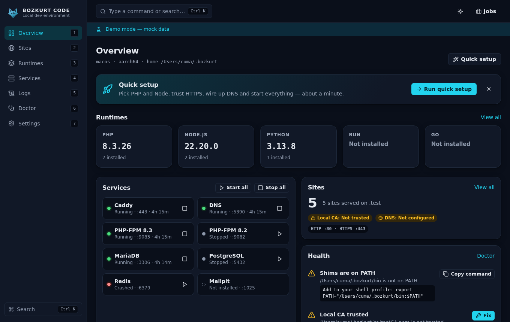
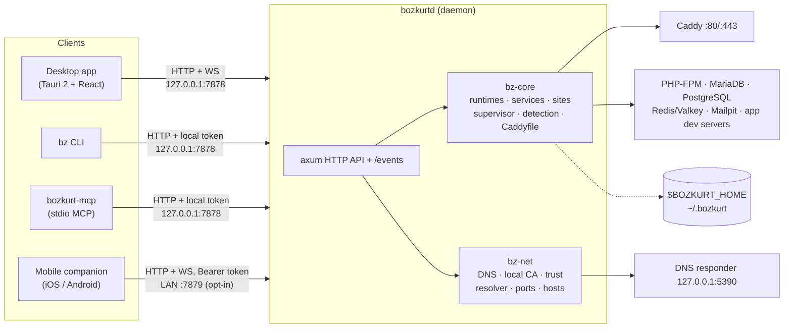

<p align="center">
  
</p>

<h1 align="center">BOZKURT CODE</h1>

<p align="center">
  <b>Your whole local dev stack in one self-contained app. macOS, Linux and Windows.</b><br>
  PHP · Node.js · Bun · Python · Go · Caddy · MariaDB · PostgreSQL · Redis/Valkey · Mailpit · local DNS · one-click HTTPS
</p>

<p align="center">
  <a href="https://github.com/cumabozkurt/bozkurt-code/actions/workflows/ci.yml"></a>
  <a href="https://github.com/cumabozkurt/bozkurt-code/releases/latest"></a>
  <a href="https://cumabozkurt.github.io/bozkurt-code/"></a>
  <a href="#license"></a>
</p>

<p align="center">
  <a href="https://cumabozkurt.github.io/bozkurt-code/"><b>Website</b></a> ·
  <a href="README.tr.md">Türkçe</a> ·
  <a href="docs/USER_GUIDE.md">User guide</a> ·
  <a href="docs/CLI.md">CLI</a> ·
  <a href="docs/MCP.md">MCP</a> ·
  <a href="docs/API.md">HTTP API</a> ·
  <a href="docs/ARCHITECTURE.md">Architecture</a> ·
  <a href="docs/COMPARISON.md">Comparison</a> ·
  <a href="docs/ROADMAP.md">Roadmap</a>
</p>

---

BOZKURT CODE is an open-source local development environment for web projects. Everything it installs goes
in **one folder** (`~/.bozkurt`, or `%LOCALAPPDATA%\Bozkurt` on Windows). There is no Homebrew, apt, choco,
Docker or VM involved. To uninstall, remove the app and delete that folder.

One engine has four faces. The **desktop app**, the **`bz` CLI**, the **`bozkurt-mcp`** server for AI coding
agents and the **mobile companion** all talk to the same local daemon (`bozkurtd`) over one
[HTTP API](docs/API.md), so you can do the same things from any of them.

> **1.0 — supported platforms and known limitations.**
> - Desktop app: macOS (Apple Silicon and Intel), Windows x64, Linux x64 and arm64. Windows on ARM runs the x64 build
>   under emulation.
> - Linux binaries are glibc-based (built on Ubuntu 22.04, glibc ≥ 2.35). musl/Alpine is not supported.
> - Bundled MariaDB: Linux x64 and Windows x64 only. Bundled Redis (Valkey): Linux only. Elsewhere, run your own
>   server on the default port and BOZKURT uses it as `external`.
>
> What changed in this release: [CHANGELOG](CHANGELOG.md). What comes next: [ROADMAP](docs/ROADMAP.md).

## Features

- **Self-contained.** Every binary, runtime, database, certificate and log lives under `$BOZKURT_HOME`. Anything written
  outside it (resolver files, hosts entries, trust stores) is backed up first to `backups/<stamp>/`.
- **Runtimes with per-site versions.**
  - PHP 8.0+: static builds from static-php.dev on macOS/Linux, official windows.php.net builds on Windows.
  - Node.js: every LTS and current release from nodejs.org, SHA-256 verified.
  - Bun, Python (python-build-standalone) and Go (go.dev).
  - Version lists come live from upstream indexes and are cached for 6 h. Switching is an atomic symlink
    (a junction on Windows) plus shims in `bin/`.
  - Versions are picked up automatically from `composer.json`, `.nvmrc`, `.node-version`, `package.json` engines,
    `.python-version` and `go.mod`.
- **Zero-config project detection.** Laravel, Symfony, WordPress (including Bedrock), Drupal, Next.js, Nuxt, Astro,
  SvelteKit, Remix/React Router, Vite, Express/Fastify/Koa, Django, Flask, FastAPI, Go, generic PHP and static sites.
- **Caddy as the front proxy on every OS.** It handles four site kinds:
  - `php`: per-version PHP-FPM pool, or a php-cgi pool on Windows.
  - `proxy`: forwards to a port you choose.
  - `static`: serves files.
  - `app`: BOZKURT runs your dev command (such as `npm run dev`), assigns `$PORT` and proxies to it.

  Wildcard subdomains, aliases, HTTP→HTTPS redirect and per-site Caddy snippets are supported.
- **Services.**
  - MariaDB. If MySQL/MariaDB is already running on :3306, BOZKURT uses it as-is.
  - PostgreSQL, Redis (Valkey) and Mailpit (SMTP catcher with a web UI).
  - Each service can be installed, started, stopped, restarted, set to autostart, and has its own log.
  - Crashed processes are restarted with backoff.
- **Local DNS.** A built-in responder answers `*.test` (the TLD is configurable). Each OS gets its own routing:
  `/etc/resolver` on macOS, systemd-resolved or NetworkManager on Linux, NRPT on Windows. The hosts file is the
  fallback.
- **HTTPS without mkcert.** BOZKURT generates its own local CA and trusts it in your *user* store where possible:
  the login keychain on macOS, `CurrentUser\Root` on Windows, the NSS databases on Linux. Leaf certificates are
  issued and renewed per site.
- **Ports.** When a port is busy, BOZKURT names the process that holds it. If 80/443 are unavailable it uses
  8080/8443 instead and shows the URLs with the port.
- **Doctor.** `bz doctor` checks ports, DNS, trust, PATH and permissions and suggests a fix for each problem.
- **Import.** It scans for Valet, Herd, MAMP, XAMPP, Laragon and Homebrew vhosts and imports the ones you confirm, with
  backups. Their DNS settings are reported (with a warning when they also route your TLD) but never changed.
- **Share.** Get an optional public URL through cloudflared, which is downloaded on demand.
- **AI agents.** `bozkurt-mcp` exposes 55 MCP tools. Destructive and system-level tools return a preview until
  they are called with `confirm: true`.
- **Mobile companion.** A LAN remote control for iOS and Android: pair with a QR code, then start and stop
  services, watch logs and manage sites from your phone.
- **Desktop.** Tauri 2 app with a tray/menu-bar menu, command palette (⌘K / Ctrl K), keyboard shortcuts, light/dark themes,
  and English and Turkish UI.

## Screenshots

| Overview | Sites | Site detail |
|---|---|---|
|  |  |  |
| **Create site** | **Runtimes** | **Services** |
|  |  |  |
| **Logs** | **Command palette** | **Quick setup** |
|  |  |  |
| **Remote access (desktop)** | **Mobile: connect** | **Mobile: overview** |
|  |  |  |

Turkish UI, light theme: [overview-tr-light.png](docs/screenshots/overview-tr-light.png)

## Install

### Desktop app (recommended)

Download the installer for your OS from [GitHub Releases](https://github.com/cumabozkurt/bozkurt-code/releases/latest):

| OS | Files |
|---|---|
| macOS (Apple Silicon / Intel) | `.dmg` (`.app` inside) |
| Windows x64 | `.msi` or NSIS `-setup.exe` |
| Linux x64 / arm64 | `.deb`, `.rpm`, `.AppImage` |

The desktop app bundles `bozkurtd`, `bz` and `bozkurt-mcp`. Every release also contains `SHA256SUMS`, and the archives
and bundles carry GitHub build-provenance attestations (`gh attestation verify <file> --repo cumabozkurt/bozkurt-code`).
`THIRD_PARTY_LICENSES.md` lists the licences of the bundled Rust and npm dependencies.
Builds are signed only when the maintainers have set up signing certificates (see [CONTRIBUTING](CONTRIBUTING.md#release-signing-secrets)).
An unsigned build can trigger Gatekeeper or SmartScreen warnings.

### CLI only (no GUI)

Both installers download `bz`, `bozkurtd` and `bozkurt-mcp` from the latest release, check them against
`SHA256SUMS` and install them into `$BOZKURT_HOME/bin`. They need no root or admin rights and write nothing outside that folder.

**macOS / Linux**

```sh
curl -fsSL https://raw.githubusercontent.com/cumabozkurt/bozkurt-code/main/scripts/install.sh | sh
# options: --version v1.0.0  --home DIR  --repo USER/REPO  --target TRIPLE   (or BOZKURT_VERSION / BOZKURT_HOME / BOZKURT_TARGET / BOZKURT_BASE_URL)
```

**Windows (PowerShell)**

```powershell
irm https://raw.githubusercontent.com/cumabozkurt/bozkurt-code/main/scripts/install.ps1 | iex
# or download it and run:  .\install.ps1 -Version v1.0.0 -AddToPath
```

> Windows on ARM installs the x64 build, which runs under emulation. On Linux the CLI needs glibc ≥ 2.35.

If `~/.bozkurt/bin` is not on your `PATH`, the installer prints the line to add.

## Quick start

```sh
bz doctor                 # what's missing? (ports, DNS, trust, PATH)
bz dns setup              # route *.test to BOZKURT (admin prompt; OS files are backed up)
bz trust                  # trust the local CA (the OS may ask for your password for the system store)
bz php install 8.3        # or: bz node install 22, bz python install 3.12, ...
cd ~/code/shop && bz link --https
bz open                   # → https://shop.test
```

The desktop app does the same through **Overview → Quick setup**.

## CLI examples

```sh
bz status                              # daemon, services, runtimes, sites
bz start all                           # start every autostart service
bz link ./api --domain api --proxy 3000 --https   # https://api.test → 127.0.0.1:3000
bz link --php 8.2                      # pin PHP for this site
bz php use 8.4                         # switch the global PHP
bz logs caddy -f                       # follow a log
bz db create shop                      # create a database on the active MariaDB/MySQL
bz share shop.test                     # public URL via cloudflared
bz sites --json | jq '.[].domain'      # every command supports --json
```

Full reference with the API endpoint behind each command: [docs/CLI.md](docs/CLI.md).

## MCP setup (AI coding agents)

`bozkurt-mcp` is a **stdio** MCP server. Its tools, safety tiers and confirmation rules are described in [docs/MCP.md](docs/MCP.md).
`bz mcp register <client>` writes the right config for you. To do it by hand:

<details open><summary><b>Claude Code</b></summary>

```sh
claude mcp add --scope user bozkurt -- bozkurt-mcp
```
or in `~/.claude.json`:
```json
{ "mcpServers": { "bozkurt": { "type": "stdio", "command": "bozkurt-mcp" } } }
```
</details>

<details><summary><b>Cursor</b>: <code>~/.cursor/mcp.json</code> (or <code>.cursor/mcp.json</code> in a project)</summary>

```json
{ "mcpServers": { "bozkurt": { "command": "bozkurt-mcp" } } }
```
</details>

<details><summary><b>VS Code (Copilot agent mode)</b>: <code>.vscode/mcp.json</code></summary>

```json
{ "servers": { "bozkurt": { "type": "stdio", "command": "bozkurt-mcp" } } }
```
</details>

<details><summary><b>Windsurf</b>: <code>~/.codeium/windsurf/mcp_config.json</code></summary>

```json
{ "mcpServers": { "bozkurt": { "command": "bozkurt-mcp" } } }
```
</details>

<details><summary><b>Gemini CLI</b>: <code>~/.gemini/settings.json</code></summary>

```json
{ "mcpServers": { "bozkurt": { "command": "bozkurt-mcp" } } }
```
</details>

<details><summary><b>Codex CLI</b>: <code>~/.codex/config.toml</code></summary>

```toml
[mcp_servers.bozkurt]
command = "bozkurt-mcp"
```
</details>

If `bozkurt-mcp` is not on the `PATH` your editor sees, use the absolute path:
`~/.bozkurt/bin/bozkurt-mcp`, or `%LOCALAPPDATA%\Bozkurt\bin\bozkurt-mcp.exe` on Windows.

## Architecture



More detail in [docs/ARCHITECTURE.md](docs/ARCHITECTURE.md). The HTTP API reference is [docs/API.md](docs/API.md).

## How it compares

A factual, sourced feature comparison with other local development tools is in [docs/COMPARISON.md](docs/COMPARISON.md).

## FAQ

**Why is the mobile app a "remote" rather than a full dev environment?**
iOS and Android do not allow apps to run arbitrary background servers, spawn PHP-FPM, MySQL or Node child processes, or
bind privileged ports. App sandboxing and store rules forbid it. A phone cannot host your dev servers, but it can
**control** the computer that does. The companion pairs with your desktop over the LAN (QR code plus an 8-digit code that
expires in 5 minutes, then a bearer token). It reuses the same React UI in "remote mode" to start and stop services,
manage sites and runtimes, and stream logs. The LAN listener is **off by default**.

**Does it touch my system PHP, MySQL or Homebrew?**
No. Runtimes live in `$BOZKURT_HOME/runtimes` and shims in `$BOZKURT_HOME/bin`. If something already holds :3306
(or :5432, :6379, :1025), the service shows as `external` and BOZKURT uses it as-is.

**Why `.test` and not `.dev`?**
`.dev` and `.app` are real, HSTS-preloaded TLDs, so the config rejects them. `.test` is reserved for exactly this use (RFC 2606).

**Does it read `.htaccess`?**
No. Caddy does not parse `.htaccess`. Framework presets (WordPress, Laravel, Symfony, generic front controller) produce
equivalent rules, and you can add a per-site Caddy snippet for anything custom.

**When does it need admin rights?**
Only to install OS DNS routing (`bz dns setup`) and, optionally, to trust the CA in the system store. Each of these is one
named step that you confirm. Everything else runs as your user. On Windows, NRPT routing needs the responder on port 53;
when that port is taken, BOZKURT falls back to the hosts file.

**Can a web page I visit talk to the local daemon?**
No. The local API on `127.0.0.1:7878` only accepts browser requests from the packaged desktop app's own origin, checks
the `Host` header (against DNS rebinding) and refuses non-JSON writes. Every other client must send the per-install token
from `$BOZKURT_HOME/api-token`, which `bz` and `bozkurt-mcp` read automatically. Sites are served on loopback only unless
you turn on `lan_access`. Details: [SECURITY.md](SECURITY.md).

**Is MariaDB/Redis available on every OS?**
Not yet. The bundled MariaDB currently covers Linux x64 and Windows x64, and bundled Redis (Valkey) covers Linux only.
On other platforms, run your own server on the default port and BOZKURT detects it as `external`. See [ROADMAP](docs/ROADMAP.md).

**Is this affiliated with any other local development tool?**
No. BOZKURT CODE is an independent project with its own design and code. Product names mentioned in
[docs/COMPARISON.md](docs/COMPARISON.md) belong to their owners.

## Contributing

Bug reports, docs and PRs are welcome. See [CONTRIBUTING.md](CONTRIBUTING.md) and the
[Code of Conduct](CODE_OF_CONDUCT.md). To report a security issue, follow [SECURITY.md](SECURITY.md).

## License

Licensed under either of

- Apache License, Version 2.0 ([LICENSE-APACHE](LICENSE-APACHE))
- MIT license ([LICENSE-MIT](LICENSE-MIT))

at your option. Unless you explicitly state otherwise, any contribution you intentionally submit for inclusion in
the work, as defined in the Apache-2.0 license, is dual licensed as above, without any additional terms or conditions.
