<p align="center">
  
</p>

<h1 align="center">BOZKURT CODE</h1>

<p align="center">
  <b>Tüm yerel geliştirme ortamınız tek ve kendi içinde bağımsız bir uygulamada. macOS, Linux ve Windows.</b><br>
  PHP · Node.js · Bun · Python · Go · Caddy · MariaDB · PostgreSQL · Redis/Valkey · Mailpit · yerel DNS · tek tıkla HTTPS
</p>

<p align="center">
  <a href="https://github.com/cumabozkurt/bozkurt-code/actions/workflows/ci.yml"></a>
  <a href="https://github.com/cumabozkurt/bozkurt-code/releases/latest"></a>
  <a href="https://cumabozkurt.github.io/bozkurt-code/"></a>
  <a href="#lisans"></a>
</p>

<p align="center">
  <a href="https://cumabozkurt.github.io/bozkurt-code/?lang=tr"><b>Web sitesi</b></a> ·
  <a href="README.md">English</a> ·
  <a href="docs/USER_GUIDE.tr.md">Kullanım kılavuzu</a> ·
  <a href="docs/CLI.md">CLI</a> ·
  <a href="docs/MCP.md">MCP</a> ·
  <a href="docs/API.md">HTTP API</a> ·
  <a href="docs/ARCHITECTURE.md">Mimari</a> ·
  <a href="docs/COMPARISON.md">Karşılaştırma</a> ·
  <a href="docs/ROADMAP.md">Yol haritası</a>
</p>

---

BOZKURT CODE, web projeleri için açık kaynaklı bir yerel geliştirme ortamıdır. Kurduğu her şey **tek bir klasörde** durur:
`~/.bozkurt`, Windows'ta `%LOCALAPPDATA%\Bozkurt`. Homebrew, apt, choco, Docker ya da sanal makine gerekmez.
Kaldırmak için uygulamayı silip bu klasörü kaldırmanız yeterli.

Tek motor, dört arayüz: **masaüstü uygulaması**, **`bz` komut satırı aracı**, yapay zekâ kodlama ajanları için
**`bozkurt-mcp`** sunucusu ve **mobil eşlikçi uygulama**. Dördü de aynı arka plan hizmetine (daemon, `bozkurtd`) aynı
[HTTP API](docs/API.md) üzerinden bağlanır. Birinde yapabildiğiniz her şeyi ötekilerde de yapabilirsiniz.

> **1.0: desteklenen platformlar ve bilinen sınırlar.**
> - Masaüstü uygulaması: macOS (Apple Silicon ve Intel), Windows x64, Linux x64 ve arm64. ARM işlemcili Windows'ta x64
>   derlemesi öykünmeyle çalışır.
> - Linux ikili dosyaları glibc tabanlıdır (Ubuntu 22.04'te derlenir, glibc ≥ 2.35). musl/Alpine desteklenmez.
> - Paketle gelen MariaDB yalnızca Linux x64 ve Windows x64'te, Redis (Valkey) yalnızca Linux'ta vardır. Diğer
>   sistemlerde kendi sunucunuzu varsayılan portta çalıştırın; BOZKURT onu `external` (harici) olarak kullanır.
>
> Bu sürümdeki değişiklikler: [CHANGELOG](CHANGELOG.md). Sıradakiler: [yol haritası](docs/ROADMAP.md).

## Özellikler

- **Kendi içinde bağımsız.** Her ikili dosya, çalışma ortamı, veritabanı, sertifika ve günlük `$BOZKURT_HOME` altında durur.
  Bu klasörün dışına yazılacak her şey (resolver dosyaları, hosts kayıtları, güven depoları) önce `backups/<zaman>/`
  altına yedeklenir.
- **Siteye özel sürümlerle çalışma ortamları:**
  - PHP 8.0+: macOS/Linux'ta static-php.dev'in statik derlemeleri, Windows'ta windows.php.net'in resmî paketleri.
  - Node.js: nodejs.org'daki tüm LTS ve güncel sürümler, SHA-256 doğrulamalı.
  - Bun, Python (python-build-standalone) ve Go (go.dev).
  - Sürüm listesi her kaynağın kendi dizininden canlı çekilir ve 6 saat önbellekte tutulur. Sürüm değiştirmek, tek
    seferde yapılan bir sembolik bağlantı değişikliğidir (Windows'ta junction); `bin/` altındaki ara komutlar (shim)
    da güncellenir.
  - Sürüm `composer.json`, `.nvmrc`, `.node-version`, `package.json` engines, `.python-version` ve `go.mod`
    dosyalarından otomatik okunur.
- **Ayarsız proje tanıma:** Laravel, Symfony, WordPress (Bedrock dahil), Drupal, Next.js, Nuxt, Astro, SvelteKit,
  Remix/React Router, Vite, Express/Fastify/Koa, Django, Flask, FastAPI, Go, düz PHP ve statik siteler.
- **Her işletim sisteminde önde çalışan ters vekil sunucu (reverse proxy) olarak Caddy.** Dört site türü vardır:
  - `php`: sürüme özel PHP-FPM havuzu (Windows'ta php-cgi havuzu).
  - `proxy`: istekleri belirlediğiniz bir porta iletir.
  - `static`: dosyaları olduğu gibi sunar.
  - `app`: BOZKURT geliştirme komutunuzu (ör. `npm run dev`) kendisi çalıştırır, `$PORT` atar ve isteği oraya iletir.

  Joker alt alan adları, takma adlar, HTTP→HTTPS yönlendirmesi ve siteye özel Caddy parçacıkları desteklenir.
- **Servisler:**
  - MariaDB. :3306'da zaten bir MySQL/MariaDB çalışıyorsa BOZKURT ona dokunmadan onu kullanır.
  - PostgreSQL, Redis (Valkey) ve Mailpit (web arayüzlü e-posta yakalayıcı, SMTP).
  - Her servis için kurma, başlatma, durdurma, yeniden başlatma, otomatik başlatma ve ayrı günlük vardır.
  - Çöken süreçler, bekleme süresi giderek artırılarak yeniden başlatılır.
- **Yerel DNS.** Dahili bir DNS yanıtlayıcı `*.test` alan adlarını yanıtlar; TLD ayarlanabilir. Her işletim sistemine
  kendi yönlendirmesi kurulur: macOS'ta `/etc/resolver`, Linux'ta systemd-resolved ya da NetworkManager, Windows'ta NRPT.
  Bunlar olmazsa hosts dosyası kullanılır.
- **mkcert gerektirmeyen HTTPS.** BOZKURT kendi yerel sertifika otoritesini (CA) üretir ve mümkün olduğunca
  *kullanıcı* deposuna güvenilir olarak ekler: macOS'ta giriş anahtar zinciri, Windows'ta `CurrentUser\Root`, Linux'ta NSS
  veritabanları. Her siteye ayrı sertifika üretilir ve süresi dolmadan yenilenir.
- **Portlar.** Bir port doluysa BOZKURT onu tutan süreci adıyla gösterir. 80/443 kullanılamıyorsa 8080/8443'ü kullanır
  ve adresleri port numarasıyla birlikte gösterir.
- **Doktor.** `bz doctor` portları, DNS'i, sertifika güvenini, PATH'i ve izinleri denetler, her sorun için çözüm önerir.
- **İçe aktarma.** Valet, Herd, MAMP, XAMPP, Laragon ve Homebrew'daki sanal sunucuları tarar; sizin onayladıklarınızı
  yedek alarak içe aktarır. Bu araçların DNS ayarları raporlanır (sizin TLD'nizi de yönlendiriyorlarsa uyarıyla) ama
  hiçbir zaman değiştirilmez.
- **Paylaşma.** İsterseniz cloudflared ile herkese açık bir adres alırsınız. cloudflared gerektiğinde indirilir.
- **Yapay zekâ ajanları.** `bozkurt-mcp` 55 MCP aracı sunar. Yıkıcı ve sistem düzeyindeki araçlar
  `confirm: true` ile çağrılmadıkça yalnızca ne yapacaklarını gösterir.
- **Mobil eşlikçi.** iOS ve Android için yerel ağ (LAN) uzaktan kumandası. QR kodla eşleştirdikten sonra telefondan
  servisleri başlatıp durdurabilir, günlükleri izleyebilir ve siteleri yönetebilirsiniz.
- **Masaüstü.** Tauri 2 tabanlı uygulama: tepsi/menü çubuğu menüsü, komut paleti (⌘K / Ctrl K), klavye kısayolları,
  açık/koyu tema, Türkçe ve İngilizce arayüz.

## Ekran görüntüleri

| Genel bakış (Türkçe, açık tema) | Siteler | Site ayrıntısı |
|---|---|---|
| 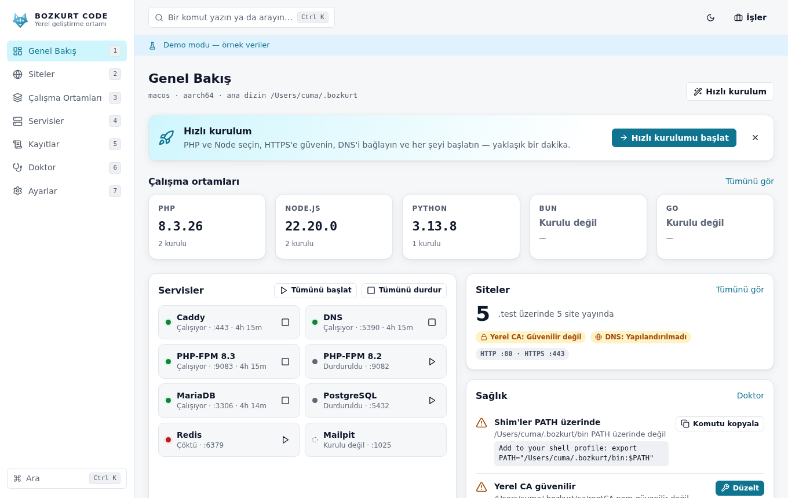 | 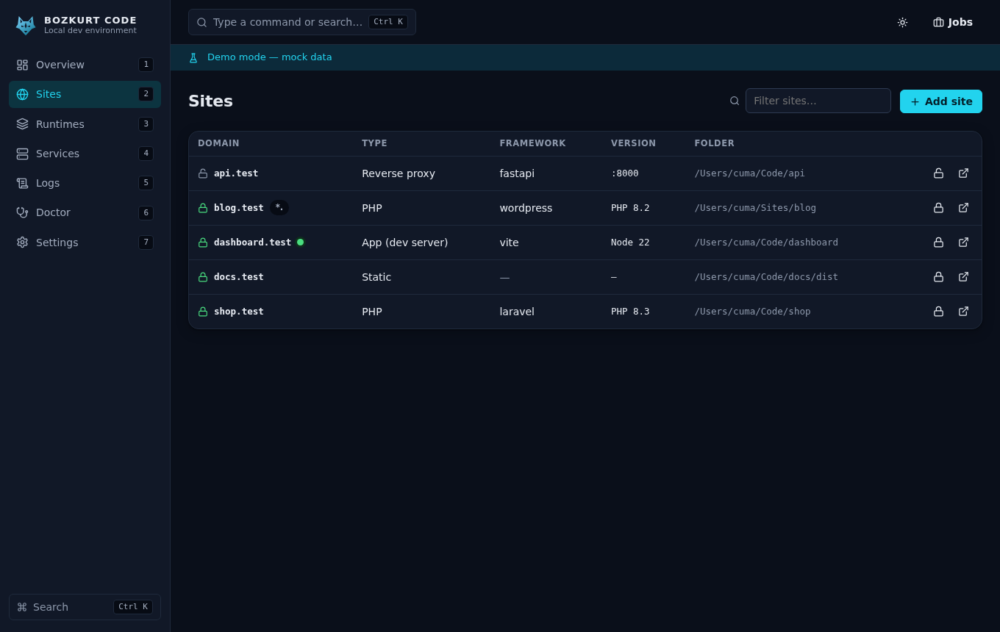 | 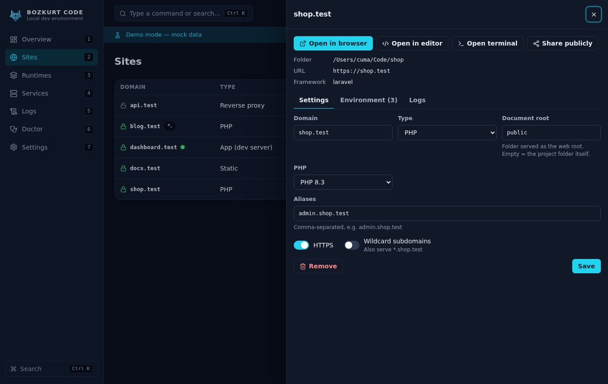 |
| **Site oluşturma** | **Çalışma ortamları** | **Servisler** |
| 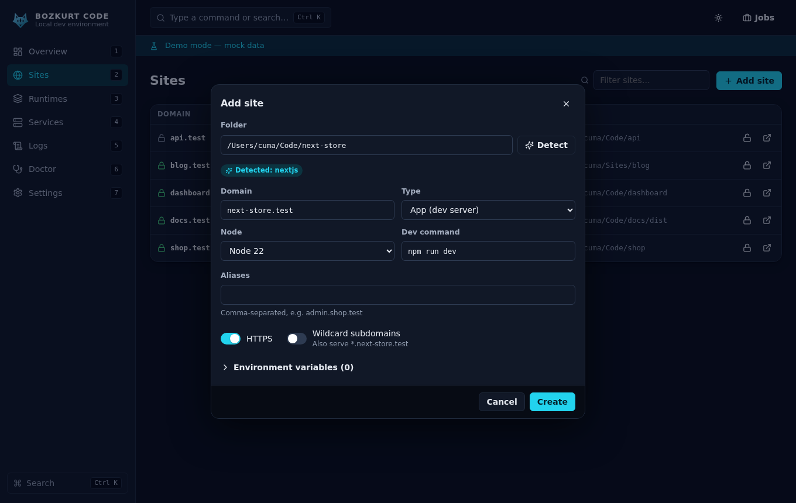 | 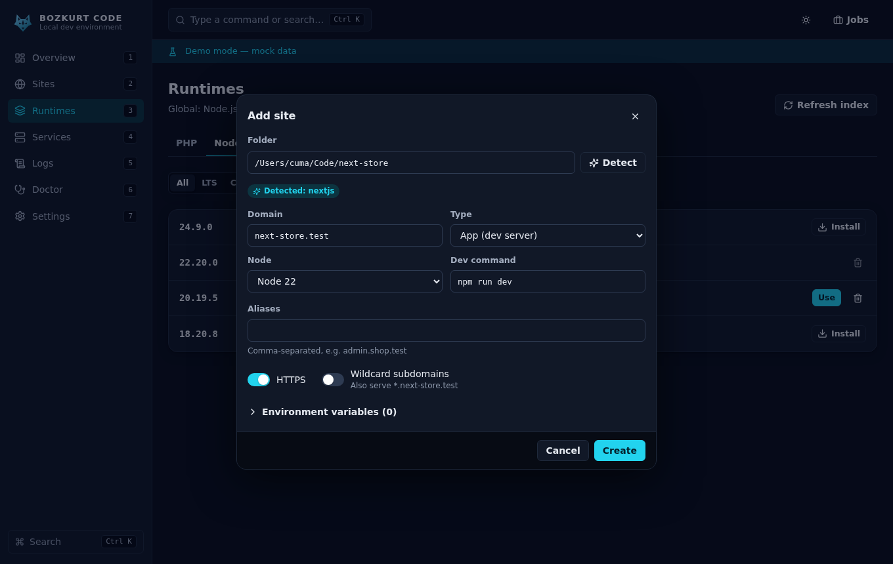 | 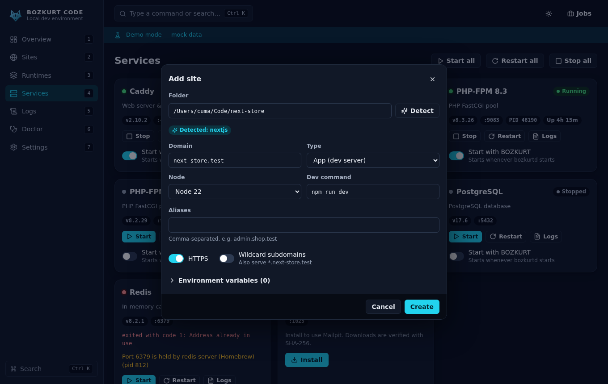 |
| **Günlükler** | **Komut paleti** | **Hızlı kurulum** |
| 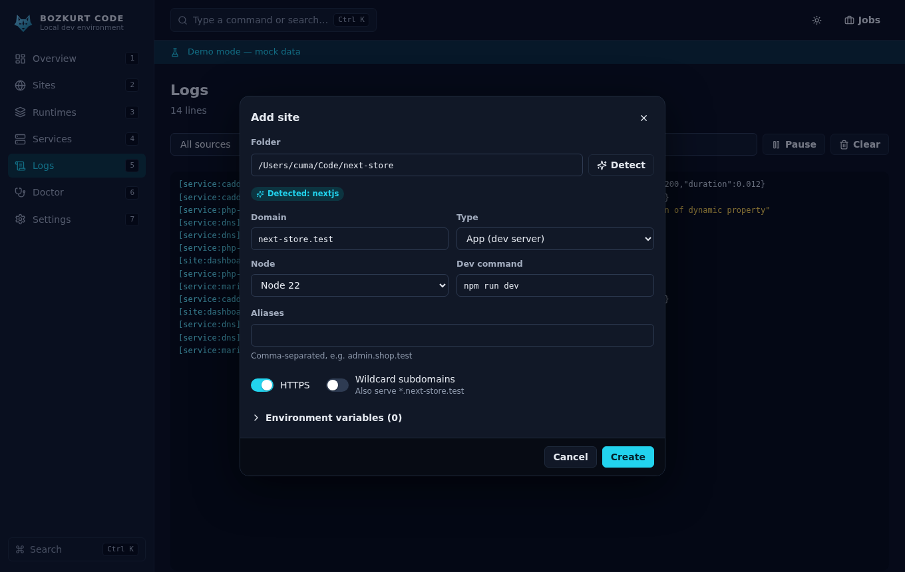 | 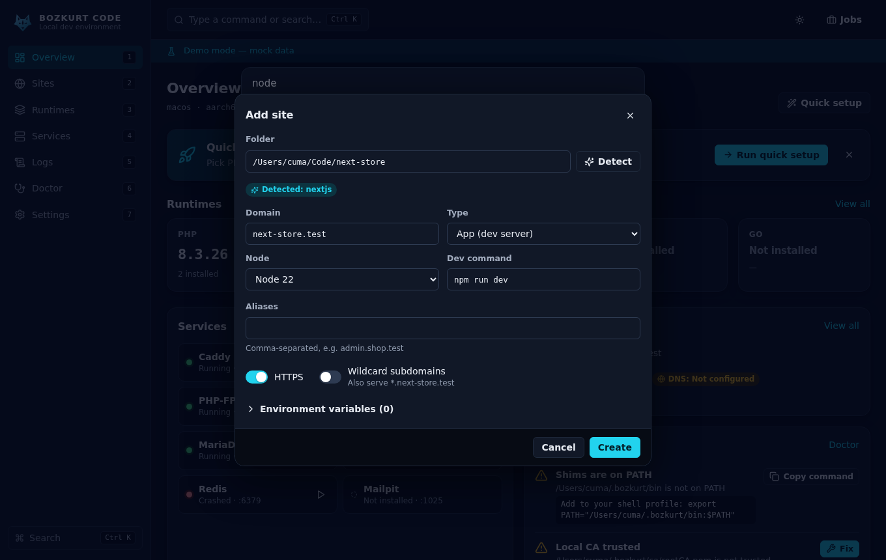 | 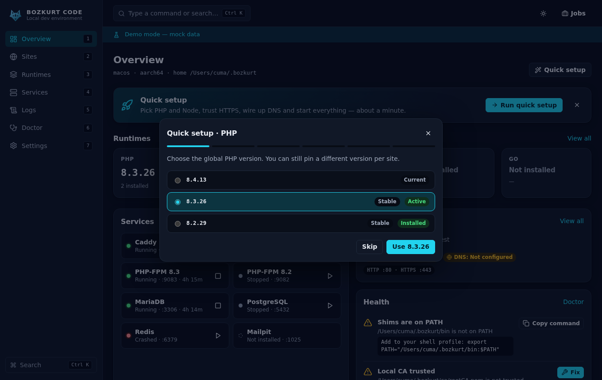 |
| **Uzaktan erişim (masaüstü)** | **Mobil: bağlanma** | **Mobil: genel bakış** |
| 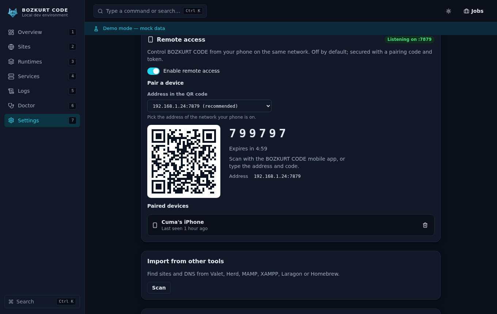 | 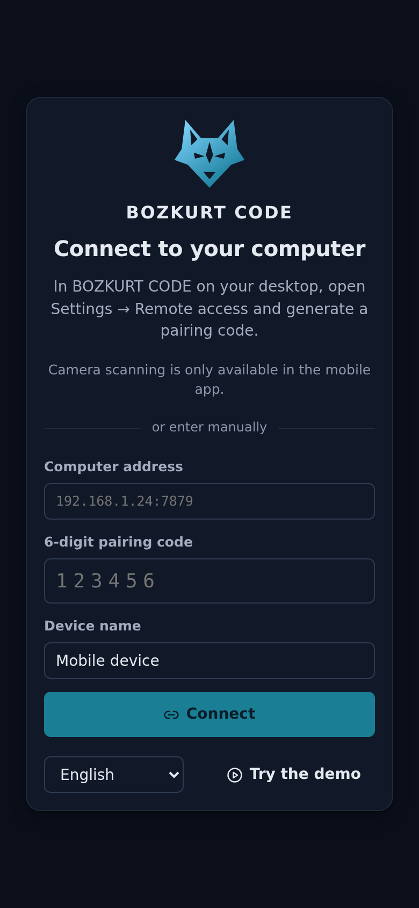 | 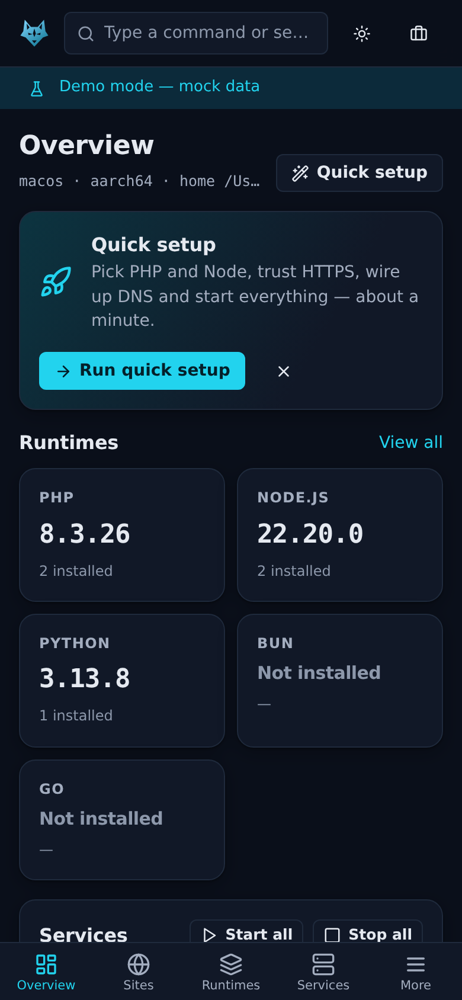 |

Koyu tema, İngilizce: [overview.png](docs/screenshots/overview.png)

## Kurulum

### Masaüstü uygulaması (önerilen)

İşletim sisteminize uygun kurulum dosyasını [GitHub Releases](https://github.com/cumabozkurt/bozkurt-code/releases/latest) sayfasından indirin:

| İşletim sistemi | Dosyalar |
|---|---|
| macOS (Apple Silicon / Intel) | `.dmg` (içinde `.app`) |
| Windows x64 | `.msi` veya NSIS `-setup.exe` |
| Linux x64 / arm64 | `.deb`, `.rpm`, `.AppImage` |

Masaüstü uygulaması `bozkurtd`, `bz` ve `bozkurt-mcp` dosyalarını içinde taşır. Her sürümde bir de `SHA256SUMS` dosyası bulunur;
arşivler ve kurulum paketleri GitHub derleme kaynağı kanıtı (build provenance attestation) taşır
(`gh attestation verify <dosya> --repo cumabozkurt/bozkurt-code`). Paketlenen Rust ve npm bağımlılıklarının lisansları
`THIRD_PARTY_LICENSES.md` dosyasındadır.
Derlemeler yalnızca bakımcılar imza sertifikalarını tanımladıysa imzalanır
(bkz. [CONTRIBUTING](CONTRIBUTING.md#release-signing-secrets)). İmzasız bir derleme Gatekeeper ya da SmartScreen uyarısı çıkarabilir.

### Yalnızca CLI (arayüzsüz)

İki kurulum betiği de en son sürümden `bz`, `bozkurtd` ve `bozkurt-mcp` dosyalarını indirir, `SHA256SUMS` ile doğrular
ve `$BOZKURT_HOME/bin` klasörüne kurar. Root ya da yönetici yetkisi istemez, bu klasörün dışına hiçbir şey yazmaz.

**macOS / Linux**

```sh
curl -fsSL https://raw.githubusercontent.com/cumabozkurt/bozkurt-code/main/scripts/install.sh | sh
# seçenekler: --version v1.0.0  --home KLASÖR  --repo SAHİP/DEPO  --target HEDEF (ör. aarch64-apple-darwin)
```

**Windows (PowerShell)**

```powershell
irm https://raw.githubusercontent.com/cumabozkurt/bozkurt-code/main/scripts/install.ps1 | iex
# ya da indirip:  .\install.ps1 -Version v1.0.0 -AddToPath
```

> ARM işlemcili Windows'ta x64 derlemesi kurulur ve öykünmeyle çalışır. Linux'ta CLI için glibc ≥ 2.35 gerekir.

`~/.bozkurt/bin` klasörü `PATH` içinde değilse betik, eklemeniz gereken satırı ekrana yazar.

## Hızlı başlangıç

```sh
bz doctor                 # eksik bir şey var mı? (portlar, DNS, sertifika güveni, PATH)
bz dns setup              # *.test alan adlarını BOZKURT'a yönlendir (yönetici onayı ister; sistem dosyaları yedeklenir)
bz trust                  # yerel CA'yı güvenilir olarak ekle (sistem deposu için işletim sistemi parola sorabilir)
bz php install 8.3        # ya da: bz node install 22, bz python install 3.12 ...
cd ~/kod/magaza && bz link --https
bz open                   # → https://magaza.test
```

Masaüstü uygulamasında aynı adımlar **Genel bakış → Hızlı kurulum** ekranındadır.

## CLI örnekleri

```sh
bz status                              # arka plan hizmeti, servisler, çalışma ortamları ve siteler
bz start all                           # otomatik başlayan tüm servisleri başlat
bz link ./api --domain api --proxy 3000 --https   # https://api.test → 127.0.0.1:3000
bz link --php 8.2                      # bu sitenin PHP sürümünü sabitle
bz php use 8.4                         # genel PHP sürümünü değiştir
bz logs caddy -f                       # günlüğü canlı izle
bz db create magaza                    # etkin MariaDB/MySQL'de veritabanı oluştur
bz share magaza.test                   # cloudflared ile herkese açık adres
bz sites --json | jq '.[].domain'      # her komut --json destekler
```

Her komutun arkasındaki API uç noktasını da gösteren tam başvuru: [docs/CLI.md](docs/CLI.md).

## MCP kurulumu (yapay zekâ kodlama ajanları)

`bozkurt-mcp` bir **stdio** MCP sunucusudur. Araçlar, güvenlik katmanları ve onay kuralları [docs/MCP.md](docs/MCP.md) dosyasında.
`bz mcp register <istemci>` doğru ayarı sizin yerinize yazar. Elle yapmak isterseniz:

| İstemci | Dosya | Ayar |
|---|---|---|
| Claude Code | komut | `claude mcp add --scope user bozkurt -- bozkurt-mcp` |
| Claude Code | `~/.claude.json` | `{ "mcpServers": { "bozkurt": { "type": "stdio", "command": "bozkurt-mcp" } } }` |
| Cursor | `~/.cursor/mcp.json` | `{ "mcpServers": { "bozkurt": { "command": "bozkurt-mcp" } } }` |
| VS Code | `.vscode/mcp.json` | `{ "servers": { "bozkurt": { "type": "stdio", "command": "bozkurt-mcp" } } }` |
| Windsurf | `~/.codeium/windsurf/mcp_config.json` | `{ "mcpServers": { "bozkurt": { "command": "bozkurt-mcp" } } }` |
| Gemini CLI | `~/.gemini/settings.json` | `{ "mcpServers": { "bozkurt": { "command": "bozkurt-mcp" } } }` |
| Codex CLI | `~/.codex/config.toml` | `[mcp_servers.bozkurt]` ↵ `command = "bozkurt-mcp"` |

Editörünüz `bozkurt-mcp` komutunu `PATH` üzerinde göremiyorsa tam yolu yazın: `~/.bozkurt/bin/bozkurt-mcp`, Windows'ta
`%LOCALAPPDATA%\Bozkurt\bin\bozkurt-mcp.exe`.

## Mimari

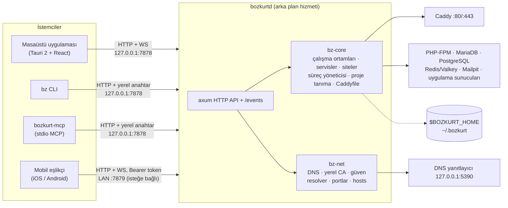

## Karşılaştırma

Diğer yerel geliştirme araçlarıyla kaynaklı ve olgusal özellik karşılaştırması: [docs/COMPARISON.md](docs/COMPARISON.md).

## Sık sorulan sorular

**Mobil uygulama neden tam bir geliştirme ortamı değil de "uzaktan kumanda"?**
iOS ve Android, uygulamaların arka planda sunucu çalıştırmasına, PHP-FPM, MySQL ya da Node gibi alt süreçler
başlatmasına ve ayrıcalıklı portları dinlemesine izin vermez. Uygulama korumalı alanı (sandbox) ve mağaza kuralları
bunu yasaklar. Telefon geliştirme sunucularınızı barındıramaz ama onları çalıştıran bilgisayarı **yönetebilir**.
Eşlikçi uygulama masaüstünüzle yerel ağ üzerinden eşleşir: önce QR kod ve 5 dakikada geçersiz olan 8 haneli bir kod,
ardından bir erişim anahtarı (bearer token). Aynı React arayüzünü "uzaktan modda" kullanır; servisleri başlatıp
durdurabilir, siteleri ve çalışma ortamlarını yönetebilir, günlükleri canlı izleyebilirsiniz. Yerel ağ erişimi
**varsayılan olarak kapalıdır**.

**Sistemimdeki PHP'ye, MySQL'e ya da Homebrew'a dokunur mu?**
Hayır. Çalışma ortamları `$BOZKURT_HOME/runtimes`, ara komutlar `$BOZKURT_HOME/bin` altında durur. :3306 (ya da :5432,
:6379, :1025) zaten başka bir süreçteyse servis `external` (harici) olarak görünür ve BOZKURT ona dokunmadan onu kullanır.

**Neden `.dev` değil de `.test`?**
`.dev` ve `.app` gerçek ve HSTS ön yüklemeli alan adlarıdır, ayarlar bunları kabul etmez. `.test` tam da bu iş için
ayrılmıştır (RFC 2606).

**`.htaccess` dosyalarını okur mu?**
Hayır, Caddy `.htaccess` okumaz. WordPress, Laravel, Symfony ve genel ön denetleyici (front controller) hazır ayarları
eşdeğer kuralları üretir. Özel ihtiyaçlar için siteye özel Caddy parçacığı ekleyebilirsiniz.

**Yönetici yetkisi ne zaman gerekir?**
Yalnızca işletim sistemine DNS yönlendirmesini kurarken (`bz dns setup`) ve isterseniz CA'yı sistem deposuna eklerken.
Her biri sizin onayladığınız, adı açıkça yazan tek bir adımdır. Geri kalan her şey sizin kullanıcınızla çalışır.
Windows'ta NRPT yönlendirmesi için yanıtlayıcının 53. portu dinlemesi gerekir; bu port doluysa hosts dosyasına geçilir.

**Ziyaret ettiğim bir web sayfası yerel arka plan hizmetiyle konuşabilir mi?**
Hayır. `127.0.0.1:7878` üzerindeki yerel API, tarayıcı isteklerini yalnızca paketlenmiş masaüstü uygulamasının kendi
kaynağından (origin) kabul eder, DNS rebinding'e karşı `Host` başlığını denetler ve JSON olmayan yazma isteklerini reddeder.
Diğer tüm istemciler `$BOZKURT_HOME/api-token` dosyasındaki kuruluma özel anahtarı göndermek zorundadır; `bz` ve
`bozkurt-mcp` bunu kendiliğinden okur. `lan_access` açılmadıkça siteler yalnızca loopback adreslerinde sunulur.
Ayrıntılar: [SECURITY.md](SECURITY.md).

**MariaDB ve Redis her işletim sisteminde var mı?**
Henüz değil. Paketle gelen MariaDB şu an Linux x64 ve Windows x64'ü, Redis (Valkey) ise yalnızca Linux'u kapsıyor.
Diğer sistemlerde kendi sunucunuzu varsayılan portta çalıştırın, BOZKURT onu `external` olarak algılar.
Bkz. [yol haritası](docs/ROADMAP.md).

**Başka bir yerel geliştirme aracıyla bağlantısı var mı?**
Hayır. BOZKURT CODE kendi tasarımı ve koduyla bağımsız bir projedir. [docs/COMPARISON.md](docs/COMPARISON.md) içinde
geçen ürün adları sahiplerine aittir.

## Katkı

Hata bildirimleri, belge düzeltmeleri ve PR'lar memnuniyetle karşılanır. Bkz. [CONTRIBUTING.md](CONTRIBUTING.md) ve
[Davranış Kuralları](CODE_OF_CONDUCT.md). Güvenlik açıklarını bildirmek için [SECURITY.md](SECURITY.md) dosyasındaki adımları izleyin.

## Lisans

Aşağıdakilerden birini seçerek kullanabilirsiniz:

- Apache Lisansı, Sürüm 2.0 ([LICENSE-APACHE](LICENSE-APACHE))
- MIT lisansı ([LICENSE-MIT](LICENSE-MIT))

Aksini açıkça belirtmediğiniz sürece, projeye dahil edilmek üzere bilerek gönderdiğiniz her katkı (Apache-2.0'daki
tanımıyla) ek bir koşul olmadan yukarıdaki gibi çift lisanslıdır.
